# Northwind Mutual — Mobile Claims Platform

The challenge primarily requests an architecture diagram, written design and presentation video. This repository additionally includes an **optional local proof of concept** to validate selected mobile offline-first, idempotency and failure-recovery behaviors. AWS production infrastructure is documented but has not been deployed.

Start with the [final architecture design](submission/ARCHITECTURE_DESIGN.md). The original challenge PDF is not present; the [coverage map](submission/REQUIREMENTS_COVERAGE.md) uses the supplied checklist. The problem is reliable claim intake during severe-weather spikes, useful mobile status tracking and safe integration with on-premises policy/claims systems.



[Full-size SVG](submission/diagrams/production-architecture.svg) · [PNG](submission/diagrams/production-architecture.png) · [Mermaid source](submission/diagrams/production-architecture.mmd)

## Design highlights

- **Durable mobile intent:** SQLite preserves drafts, files and an outbox; a stable clientClaimId makes a lost-response replay return the original claim.
- **Explicit acknowledgment:** Waiting to send means local only. Submitted means the platform confirmed acceptance; photographs may still be pending.
- **Independent evidence recovery:** direct presigned PUT, per-file receipt confirmation and upload-only retry avoid another intake operation.
- **Clear state ownership:** React for temporary state, SQLite for durable work, TanStack Query for server reads; saved response snapshots restore previously fetched information.
- **Decoupled legacy processing:** transactional outbox, queue, independent workers and reconciliation isolate downstream outages. Distributed delivery remains at-least-once.
- **Mobile lifecycle and identity:** foreground/reconnection recovery, customer-scoped databases/query keys and session-fenced sync. Fully closed apps are not guaranteed to synchronize.

See [decisions and trade-offs](submission/DECISIONS_AND_TRADEOFFS.md) for the choices and accepted costs.

## What the repository demonstrates

| Evidence boundary | Contents |
|---|---|
| Implemented locally | Expo SDK 58 / React Native app and Expo Router; SQLite v2 drafts/outbox/snapshots; TanStack Query hydration; Fastify intake and customer access; PostgreSQL transactions/idempotency; worker delivery and leased status reconciliation |
| Local substitutes | LocalStack with the real S3 client/presigner; PostgreSQL message queue with retry/visibility/DLQ; two dev JWT issuers; HTTP on-premises stand-in; notification records rather than device push |
| Production design only | CloudFront/WAF/API Gateway/private ALB, Fargate autoscaling, RDS/Proxy/Multi-AZ, SQS, Cognito/Entra federation, employee tools, malware quarantine/access gating, KMS/secrets, cloud tracing and regional DR |

The local worker passes document names, not evidence bytes, to the legacy stand-in. Receipt checks size/type, not malware cleanliness or a server-verified checksum. The API rejects unsupported production/real-auth startup. This is a local demonstrator, not a deployable production stack.

## Run locally

Prerequisites: Node.js ≥22.13, npm, Docker Desktop, and an iOS simulator or Android emulator for the optional mobile demonstration. The validated manual environment was iPhone 16e / iOS 26.0 / Expo Go. Android UI and physical-device uploads were not validated.

```bash
# Repository root
npm install
npm run infra:up
```

Run each process in its own terminal from the repository root:

```bash
npm run api         # Fastify :3000; local migrations, seeded customer/policies and bucket setup
npm run onprem      # on-premises stand-in :4000
npm run worker      # outbox publication, queue consumption and status reconciliation
npm run mobile:ios  # Expo development server; open the iOS simulator
# Alternative: npm run mobile:android
```

Check `curl http://localhost:3000/health` for database/storage readiness before the demo. Local defaults are in [API config](apps/api/src/config.ts); [example variables](apps/api/.env.example) list overrides. Startup uses defaults/process environment; do not assume a copied .env is automatically loaded. There is no implemented `npm run demo` or load-test script. Stop local containers with `npm run infra:down` when finished.

Optional API-only smoke:

```bash
curl http://localhost:3000/health
curl http://localhost:3000/v1/app-config
TOKEN=$(curl -s -X POST http://localhost:3000/dev/auth/customer | node -e 'let s="";process.stdin.on("data",d=>s+=d);process.stdin.on("end",()=>console.log(JSON.parse(s).accessToken))')
curl -H "Authorization: Bearer $TOKEN" http://localhost:3000/v1/me
curl -H "Authorization: Bearer $TOKEN" http://localhost:3000/v1/policies
```

Local dev/fault routes are intentionally demo controls; local mode must stay within the development environment.

## Demonstrate recovery

1. Sign in online, open policies and fetch a claim detail/history to create saved snapshots.
2. In Settings, enable Force offline. Create and save a draft, reopen it, then Submit. Show Waiting to send.
3. Restore connectivity and keep the app foreground. Show the accepted reference, independent photo progress and confirmed receipt. Drop the next upload or Retry uploads demonstrates deterministic media recovery.
4. For process-restart recovery with an unavailable backend, follow the [portable demo procedure](docs/MOBILE_OFFLINE.md#assessment-demo-script). The diagnostic offline flag resets with the process; it does not establish OS airplane-mode behavior.
5. Simulate legacy failure, submit a claim, then restore legacy and observe eventual processing:

```bash
curl -X POST http://localhost:4000/dev/faults -H 'content-type: application/json' -d '{"mode":"down"}'
# Restore when ready:
curl -X POST http://localhost:4000/dev/faults -H 'content-type: application/json' -d '{"mode":"ok"}'
```

See [failure scenarios](docs/FAILURE_SCENARIOS.md) for exact automated/manual boundaries. Restarted API dev signing keys can require re-login. Local upload URLs use `localhost:4566`; a physical device requires reachable storage configuration, not just a reachable API.

## Validation and limits

```bash
npm run lint
npm run typecheck
npm test  # API integration requires local Postgres and LocalStack
```

**Recorded Phase 6.5 evidence (2026-11-07):** API 50 passing tests; final mobile command 45 Jest + 34 SQLite/sync tests, no skips. The earlier combined root run had 44 Jest tests before the final stall regression. iOS export passed, which proves bundling rather than signing or store delivery. Scoped Maestro simulator flows exercised saved reads, unavailable-backend restart and native photo recovery. These are recorded results, not newly rerun tests for this documentation task. [Exact commands and scope](docs/IMPLEMENTATION_STATUS.md#phase-65--mobile-hardening-2026-11-07).

**Submission preparation (2026-11-11):** workspace lint and typecheck passed. See [delivery verification](submission/REQUIREMENTS_COVERAGE.md#delivery-verification) for diagram and link checks.

Remaining limitations include real federation/refresh, live policy eligibility, employee claim operations, immutable audit capture, malware scanning/access gating, mobile retention/encryption, PDF picker, pagination/performance and physical-device/Android validation. Account isolation is tested automatically, but the UI exposes one seeded demo identity. Regional recovery, cloud throughput and availability targets are not validated. Legacy dedupe and lookup durability remain external assumptions.

## Submission reading order

1. [Architecture design](submission/ARCHITECTURE_DESIGN.md) — primary standalone deliverable.
2. [Three architecture diagrams](submission/diagrams/README.md) — production, offline sequence, recovery.
3. [Decisions and trade-offs](submission/DECISIONS_AND_TRADEOFFS.md) — reviewer depth.
4. [Requirements coverage](submission/REQUIREMENTS_COVERAGE.md) — completeness, evidence and consistency notes.
5. [Presentation script](submission/PRESENTATION_SCRIPT.md) — candidate recording guide; **video link pending candidate recording**.
6. [Interview preparation](submission/INTERVIEW_QA.md) — 36 technical questions, weighted toward mobile.

Engineering background: [ADRs](docs/ARCHITECTURE_DECISIONS.md), [assumptions](docs/ASSUMPTIONS.md), [Phase 6 audit](docs/PHASE_6_AUDIT.md), [implementation matrix](docs/IMPLEMENTATION_MATRIX.md). Historical documents contain superseded statements; the final submission explicitly identifies those in its consistency review.
