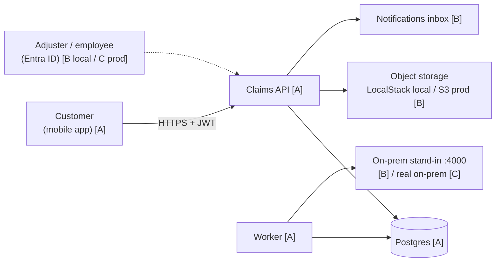
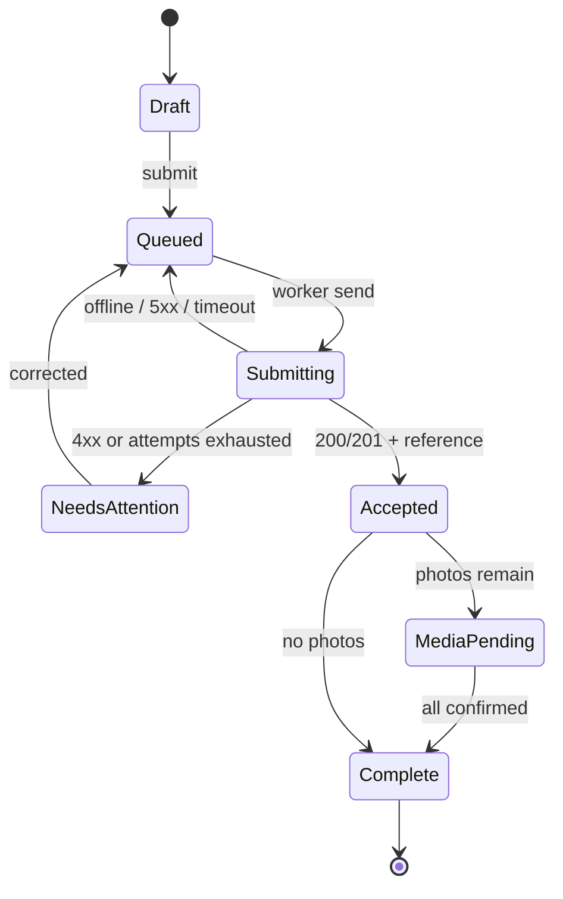
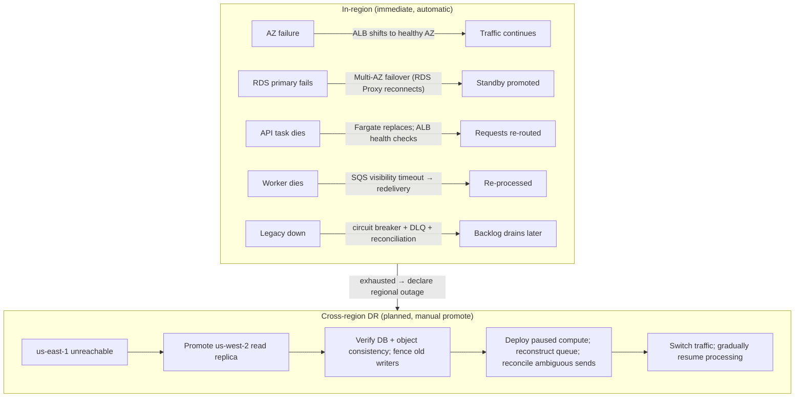
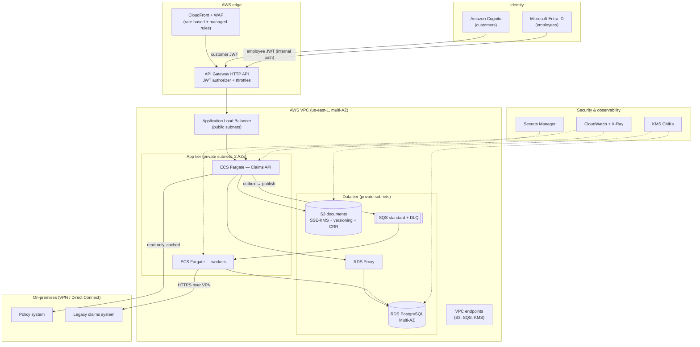

# Architecture

This is the canonical description of the Northwind Mutual Mobile Claims Platform. It is
consistent with `ARCHITECTURE_DECISIONS.md` (ADRs), `IMPLEMENTATION_MATRIX.md` (A/B/C
levels), `ASSUMPTIONS.md`, `SECURITY_AND_RELIABILITY.md`, and the Mermaid diagrams in
`docs/diagrams/`.

## Reading guide

- **A tag** = implemented and tested locally.
- **B tag** = real application code against a realistic local substitute.
- **C tag** = designed and documented only (production topology), no code, not deployed.
- Every AWS service described as production is **C** unless its client code is exercised
  locally via a substitute (then the boundary is **B** and the AWS service is **C**).

## 1. System context



The platform's job is **intake and tracking**. It accepts a claim, confirms acceptance with
a reference number, stores evidence, and delivers a status timeline. It is not the system of
record for adjudication — see §3.

## 2. Components and responsibilities

| Component | Responsibility | Level |
|---|---|---|
| Mobile app | Draft + submit claims, capture photos, persist offline, sync, display status | A |
| Claims API (Fastify) | Authenticate/authorize, validate, accept claims, issue references, presign uploads, serve status | A |
| Worker process | Drain the queue, call the legacy system, reconcile status, record notifications | A |
| Postgres | Source of truth for intake, outbox, queue, document metadata, mirrored timeline | A |
| Object storage | Store photographs/documents; presigned PUT/GET | B (client) / C (S3) |
| Message queue | Reliable, at-least-once delivery with visibility timeout + DLQ | B (Postgres) / C (SQS) |
| Identity providers | Customer (Cognito) vs employee (Entra ID) tokens | B (local issuers) / C (real) |
| Notification provider | Status delivery hints | B (inbox) / C (push) |
| Legacy gateway | Create claim + query status on the on-premises system | B (stub) / C (on-prem) |

### Synchronous vs asynchronous

| Operation | Mode | Path |
|---|---|---|
| Login / token refresh | Sync | mobile → issuer |
| Create claim | Sync | mobile → API → Postgres (returns reference immediately) |
| Upload document | Sync (from the app's view) | mobile → presigned URL → object storage |
| Deliver to legacy system | **Async** | API outbox → queue → worker → legacy |
| Status reconciliation | **Async** | worker polls legacy → writes timeline → notification |
| Malware scan | **Async** | (production) S3 event → GuardDuty; local: flagged `not_scanned` |

The only synchronous guarantee the API makes is "your claim is accepted and durably stored".
Everything downstream of that is asynchronous and eventually consistent.

## 3. Data model and source of truth

### Who owns what

| Entity | System of record | Platform's copy |
|---|---|---|
| Policy / coverage | On-premises policy system | Production: read-only snapshot with TTL/device cache; local: seeded list only |
| Claim submission + evidence + intake timeline | **Platform (Postgres + object storage)** | Authoritative |
| Adjudication status, payout, adjuster notes | **Legacy claims system** | Mirror: append-only `claim_status_events`, reconciled |
| Customer identity | Cognito | `customer_id`; every row is scoped by it |
| Employee identity | Entra ID | Roles only; never a tenant for customer data |

### Tables (local Postgres, also the production shape)

- `customers` — local stand-in for the Cognito subject → `customer_id`.
- `policies` — cached policy snapshot.
- `claims` — one row per submission: `claim_id`, `customer_id`, `client_claim_id`
  (unique per customer), `reference`, `policy_number`, `intake_status`, `legacy_status`
  (last known downstream status), `reconcile_at` (next poll time), timestamps.
- `claim_documents` — metadata per attachment: key, size, content type, sha256, status
  (`pending_upload` → `uploaded` → `complete`), `scan_status`.
- `claim_status_events` — append-only timeline (`received`, `queued_for_legacy`,
  `sent_to_legacy`, `legacy_accepted`, `under_review`, `approved`, `denied`, `closed`, …).
- `outbox_events` — durable events written in the same transaction as the claim.
- `queue_messages` + `queue_dead_letters` — the local MessageQueue (B).
- `notifications` — inbox items (B).
- `idempotency` — `Idempotency-Key` → response hash for 24h.
- `audit_events` — intended audit trail; local table has no writer or immutable enforcement.

### Status model

Two independent state machines that must not be conflated:

**Device state** (what the customer sees, driven by the mobile outbox):



**Intake/legacy state** (what the backend tracks, mirrored into the timeline):

```
received → queued_for_legacy → sent_to_legacy → legacy_accepted
                                        └→ legacy_rejected / needs_review
```

Post-intake states from the legacy system are appended to the timeline verbatim; unknown
values render as "Updated" in the app (tolerant parsing).

### The non-negotiable copy mapping

| Device state | Copy shown |
|---|---|
| `draft` | "Saved on this device" |
| `queued` / `submitting` | "Waiting to send — retries automatically" |
| `accepted` | "Submitted · `reference`" (only after server confirmation) |
| `media_pending` | "Submitted · photos still uploading" |
| server `received`/`queued_for_legacy` | "Received — sending to claims team" |
| server `legacy_accepted`+ | "With the claims team" / mirrored status |

A single mapping function + unit tests enforce this; no screen may invent its own wording.

## 4. Request and data flows

### 4.1 Claim submission (two-phase)

1. The customer completes the wizard; the draft and attachments persist to SQLite.
2. On submit, the app mints a `clientClaimId` and writes it with the claim row and an
   outbox item in one SQLite transaction.
3. The sync worker `POST /v1/claims` with the payload and a manifest of declared documents
   (name, sha256, size, content type).
4. The API validates, verifies idempotency, commits `claims` + `outbox_events` + document
   metadata in one Postgres transaction, and returns `reference` + per-document presigned URLs.
5. The app uploads each file to its presigned URL with progress, then calls
   `POST /v1/claims/{id}/documents/{docId}/complete`.
6. Claims with declared documents stay `media_pending`; the publisher holds their durable
   outbox event until every document passes metadata validation. Completion changes intake to
   `received`. The worker checks readiness again before legacy delivery. Locally this is
   metadata readiness only, not malware clearance (see §5).

### 4.2 Status update

1. Worker calls legacy `getStatus(reference)` on a schedule or after a create.
2. Changes are appended to `claim_status_events` atomically with the mirrored status.
   Notifications are written on delivery outcomes; reconciliation does not send notifications.
3. The app receives a push hint (B: inbox trigger) or refreshes on foreground / pull.
4. `GET /v1/claims/{id}/events` (full timeline; no since filter) returns the reconciled timeline.

### 4.3 Failure paths

- Legacy down → breaker opens → outbox/queue retries with backoff → no submission is lost.
- Queue consumer stopped → messages accumulate → API keeps accepting → restart drains eligible messages (at-least-once; retries may reorder).
- Poison message → exceeds attempts → DLQ → `/dev/metrics` reports its count (no dead-letter listing endpoint).
- Duplicate delivery → idempotency (client key on intake, reference on the legacy call)
  makes redelivery safe.

### 4.4 Status reconciliation (ADR-016)

The legacy system cannot push status (assumption A1), so the worker polls it:

1. Delivery sets `intake_status = legacy_accepted` and `reconcile_at = now()`.
2. The worker periodically leases due claims (`reconcile_at <= now()`, `FOR UPDATE SKIP LOCKED`),
   calls `getStatus(reference)`, and, when the status changed, appends a timeline event.
3. `denied`/`closed` are terminal: the claim is parked (`reconcile_at = NULL`).
   Each lease advances a generation; stale polls cannot write timeline/status or reschedule
   terminal claims. Timeline and mirrored state commit together. `approved` is nonterminal
   because payment/closure may follow. No approved→denied business rule is supplied; the
   platform mirrors the legacy result without adjudicating it. Owner confirmation and a
   legacy event ordering contract are required before enforcing more transitions.
4. A poll failure only backs off the next poll (`reconcile_attempts`, exponential to 5 min);
   it never mutates the claim, so an accepted claim is never invalidated.

## 5. Security

| Concern | Design |
|---|---|
| Customer auth | Cognito user pool, auth-code + PKCE (production). Local: dev issuer. Production access + refresh tokens held in `expo-secure-store`, never in SQLite |
| Employee auth | Entra ID, **separate audience**, separate internal route; never interchangeable with customer tokens |
| Authorization | JWT `sub` → `customer_id`; RBAC by `role` claim (customer / adjuster / supervisor / admin). Customer claim lookups require `customer_id`; document/event helpers are internal and require a preceding owned-claim lookup |
| Transport | TLS everywhere (production: CloudFront → API Gateway → ALB → Fargate, all TLS) |
| At rest | Postgres encryption (RDS), S3 SSE-KMS, `expo-secure-store`/Keychain for tokens |
| Uploads | Presigned PUT with signed `content-length`/`content-type`, 5-min expiry, customer/claim-scoped keys, post-upload `HeadObject` validation, mismatch remains pending locally; production quarantine |
| Downloads | Production: authorized clean-version presigned GET only. Local: no download endpoint |
| Secrets | AWS Secrets Manager (production); local `.env` (git-ignored) |
| PII | Redaction in logs (bodies/notes never logged); retention 7y claims, 1y audit, 90d logs |
| Audit | Production: immutable emitted audit + CloudTrail. Local: unused audit_events schema only |
| Tenant isolation | No shared keys, no cross-customer query path; a test asserts a customer cannot read another's claim |

### Malware scanning (B/C)

Local substitute: documents are recorded with `scan_status = 'not_scanned'`, surfaced in the
API and UI, so no one believes scanning occurred. Production: GuardDuty Malware Protection
for S3 must feed a fail-closed, version-bound release gate: private quarantine → metadata/
checksum validation → scan → clean/rejected → authorized clean-only access. Missing/failed
scans remain inaccessible. See SECURITY_AND_RELIABILITY §2.5; this gate is production-only.

## 6. Scalability and high availability

### What actually happens during a severe-weather spike (production, C)

1. **Edge:** CloudFront + WAF (rate-based rules, bot control) absorb and shed abuse.
2. **Throttle:** API Gateway route throttles cap burst before it reaches compute.
3. **Scale:** ECS Fargate scales on request count *and* queue depth, with a floor of warm
   tasks during severe-weather season; scheduled pre-scaling avoids cold-start lag.
4. **Write path:** one short transaction (claim + outbox + document metadata) through RDS
   Proxy, so the connection count is bounded and independent of task count.
5. **Backpressure:** above SLO the API sheds with `429 + Retry-After`; the mobile outbox
   treats 429 as "retry later", not a user error — backpressure is lossless.
6. **Load leveling:** photo bytes go direct to S3; the legacy system is fed through SQS
   with fixed consumer concurrency, so on-prem sees a flat rate and the backlog drains over
   hours.
7. **Degradation order:** reads serve cached data first; non-essential work is disabled by
   a remote "storm mode" flag; **claim submission is the last thing to be reduced.**

### Degradation matrix

| Failure | Customer impact | Recovery |
|---|---|---|
| Legacy down | Claim still submitted; status pauses at "sending to claims team" | Breaker → retries → reconciliation on recovery |
| SQS down (prod) | Outbox retains events; publisher retries | Drains on recovery; no loss |
| DB write slow | `429` with `Retry-After` | Client backoff; autoscale |
| Object storage down | Claims accepted; uploads retry | Presigned URLs re-issued per attempt |
| Push down | Status still available by pull | "last updated" shown |

### Disaster recovery (production, C)

| Aspect | Design |
|---|---|
| Region | Primary `us-east-1`, DR `us-west-2` |
| Database | RDS PostgreSQL Multi-AZ (RPO ≈ 0 in-region) + cross-region read replica (asynchronous; 5-min RPO target, not guaranteed) |
| Objects | S3 + asynchronous Cross-Region Replication; object lag tracked separately, no 5-min guarantee |
| Compute/state | Fargate re-deployed from images; regional queue reconstructed from DB; evidence bytes also durable state |
| **Target RTO** | 1 hour |
| **Target RPO** | 5 minutes |
| Strategy | Pilot-light (cheaper than warm standby); documented promote runbook |




The local environment reproduces **none** of this (single Postgres/LocalStack) — it is designed,
not demonstrated, and is labeled C throughout.

Recovery is operator-led; the on-call incident commander owns the declaration, DBA owns
promotion and consistency checks, integration owner reconciles external outcomes, and security
owner verifies evidence access. The canonical queue/DR procedure is
`SECURITY_AND_RELIABILITY.md` §3.11. RTO 1 hour and RPO 5 minutes are planning targets,
contingent on lag and rehearsed recovery. Missing object replicas can extend evidence RPO/RTO.

~2 claims/s normal and ~50 claims/s storm traffic for hours are planning assumptions (A8),
not measured benchmarks. Before production commitments, load-test DB writes/locks, connection
pools, publisher/consumer concurrency, storage upload throughput and legacy capacity. Local
concurrent-submission tests prove deduplication under contention, not AWS capacity.

## 7. Observability

Production design: carry a trace context across device, API, outbox, queue and legacy.
Local implementation creates an x-correlation-id per request; this is not W3C traceparent
and is not propagated into outbox/legacy calls. Logs use pino with authorization redaction and omit request bodies. Production PII
controls require review of dependency error details; customerIdHash is not implemented.

| Signal | Local (B) | Production (C) |
|---|---|---|
| Backend logs | pino → stdout | CloudWatch Logs, 90-day retention |
| API latency / errors | `/dev/metrics` counters | CloudWatch metrics + alarms |
| DB performance | pg logs | Performance Insights + RDS metrics |
| Queue depth / age | `/dev/metrics` | SQS `ApproximateAgeOfOldestMessage` |
| Failed integrations | structured log + alert record | Custom metric + alarm |
| Upload failures | mobile error log | Client-side error sink |
| End-to-end tracing | `correlationId` in logs | X-Ray / OpenTelemetry |

Actionable alert rules (each with a runbook line):

- claim-submit success rate < 99% over 5 min (operational incident alert, not SLO breach)
- DLQ depth > 0
- outbox age > 10 min
- legacy error rate / breaker open > 2 min
- DB connections > 80% of max
- p95 intake latency > 1.5 s
- auth failure rate spike
- upload failure rate > 5%

Submission availability SLO: ≥99.9% over a rolling 30-day window. Count eligible valid,
authorized submission attempts accepted durably (including idempotent replays); exclude invalid
requests/auth failures, include capacity 429, dependency/server failures and edge timeouts.
Measure at the edge so a dead API is counted. Offline attempts not yet sent are outside the
server denominator. The <99%/5-min alert detects acute degradation quickly with less short-window
noise; it is an incident signal, not a 30-day SLO breach indicator. Track error budget burn
separately; low traffic needs minimum-volume or synthetic checks. Local counters do not
implement this production measurement pipeline.

## 8. AWS service catalogue (production, C)

For every AWS service in the target topology: responsibility, why, requirement addressed,
local equivalent, expected production configuration, and failure behaviour. The full topology
is in `docs/diagrams/production-topology.mmd` and rendered below (Level C — nothing here is
provisioned or tested):



### Why these services (and why not the obvious alternatives)

- **API Gateway HTTP API in front of an ALB.** The HTTP API provides the managed JWT
  authorizer (Cognito and Entra ID), per-route throttling, and request validation the mobile
  bearer-token flow needs, at ~$1/M requests; the ALB remains for target-group health checks
  and path routing. Trade-off: one extra hop. An ALB alone cannot validate a mobile JWT bearer
  token as cleanly (ALB OIDC targets browser sessions), and API Gateway REST is ~3.5× the cost
  for features not used here.
- **ECS Fargate, not Lambda or EKS.** The API and worker hold a long-lived Postgres connection
  pool and run a continuous poller; Fargate avoids cold starts and the 15-minute Lambda cap,
  and is far simpler to operate than EKS at this scale (~50 claims/s peak).
- **RDS PostgreSQL Multi-AZ + RDS Proxy, not Aurora.** At ~2 claims/s normal and ~50 claims/s
  peak, plain RDS Multi-AZ is the cheaper, simpler choice; RDS Proxy bounds connection count
  independent of task count and smooths failover. Aurora (and Aurora Global Database) is the
  documented upgrade path if a cross-region RPO of seconds is ever required — see ADR-017.
- **SQS standard + DLQ, not FIFO.** Ordering is not required because intake deduplicates on
  `clientClaimId` and the legacy call deduplicates on the claim reference — idempotency, not
  ordering, is the correctness mechanism. Standard queues give higher throughput with no
  ordering tax.
- **S3 presigned PUT, not proxying through the API.** The app uploads bytes directly to S3, so
  Fargate never pays for customers' photos and interrupted uploads retry independently; the API
  only issues the signed URL and validates afterwards (`HeadObject`).
- **Site-to-Site VPN first, Direct Connect as an upgrade.** VPN meets the volume and cost
  profile for a request/response legacy API; Direct Connect becomes justified only if the
  legacy team proves sustained high throughput or a hard latency/SLA requirement.
- **EventBridge deferred.** One consumer group (workers) does not justify a fan-out bus; it
  becomes the natural seam the day notifications, analytics, or audit need independent
  consumers.

| Service | Responsibility / why | Requirement | Local equivalent | Production config | Fails by |
|---|---|---|---|---|---|
| CloudFront + WAF | Edge cache + bot/rate protection | Storm resilience | — | Rate-based rules, managed rules | Degrades to origin; WAF sheds abuse |
| API Gateway (HTTP) | Single public entry, JWT auth, route throttles | Secure API, backpressure | Fastify direct | Route throttles, JWT authorizer | `429`; client retries |
| ECS Fargate | Run API + workers, autoscale | Scalability | Node processes | Min/max tasks, queue-depth target tracking | ECS replaces tasks; ALB removes unhealthy targets; client retries |
| RDS PostgreSQL Multi-AZ + RDS Proxy | Durability + bounded connections | Availability | Postgres 16 container | Multi-AZ, db.r6g.xlarge, proxy pool | Automatic failover |
| S3 | Object storage, presigned PUT | Document uploads | LocalStack | SSE-KMS, versioning, lifecycle | Presigned URL invalid → client re-requests |
| SQS + DLQ | Load leveling, reliable delivery | Legacy resilience | Postgres queue | Standard queue, visibility 30s, DLQ redrive | Message redelivery; DLQ isolates poison |
| Cognito | Customer identity | Auth | Local issuer | User pool, PKCE, MFA | Token refresh fails → re-login |
| Entra ID | Employee identity | Internal auth | Second local issuer | Separate audience, conditional access | — |
| KMS | Encryption keys | At-rest encryption | — | CMK, yearly rotation | — |
| Secrets Manager | Secrets | Secrets mgmt | `.env` | Auto-rotation | — |
| GuardDuty Malware Protection | Scan uploaded objects | Security | `not_scanned` flag | Scan on upload events | Quarantine tag |
| CloudWatch + X-Ray | Metrics, logs, traces | Observability | pino + `/dev/metrics` | Alarms per §7 | Alarm fires |
| AWS Backup | Postgres snapshot/retention | DR | — | Nightly + PITR | Restore from snapshot |

The DR topology and failure-recovery paths are in §6 and `docs/diagrams/failure-recovery.mmd`;
security and reliability controls are detailed in `SECURITY_AND_RELIABILITY.md`.

## 9. Migration and mobile version compatibility

### Strangler migration from the existing backend

1. **Shadow:** read-only comparison; never replay a customer write to both intake paths.
2. **Ramp:** an application routing layer assigns a stable owner by customer/cohort before
   intake (1% → 10% → 50% → 100%). CloudFront weighting alone cannot guarantee sticky writes.
   Persist the assignment or use a stable routing key; retries and claim reads remain with
   the original owner even if the ramp percentage changes.
3. **Cutover:** the new platform owns intake/evidence for assigned claims; legacy owns
   adjudication. Its worker is the sole creator of the corresponding legacy claim, using
   the stable platform reference. Old intake must not also create it. No dual-write design.
4. **Rollback:** stop assigning new claims to the new intake path; retain ownership, reads,
   uploads and queue draining for claims already accepted there. Pause affected delivery if
   needed. Never copy/replay accepted claims through the old creation endpoint. Reconcile
   both inventories by platform reference and persisted legacy number with the integration
   owner; hold ambiguous sends for manual lookup before retry. Fence obsolete workers/writers
   before any ownership transfer. This is a production rollout procedure, not implemented
   local routing infrastructure.

Feature flags (`/v1/app-config`) gate new behaviour so a deploy does not require a
coordinated app release.

### Older app versions

- APIs are **additive-only**; breaking changes get a new path version (`/v2/...`).
- Tolerant enum parsing: unknown status values render as "Updated", never crash.
- `/v1/app-config` returns `minSupportedVersion`, `latestVersion`, `features`, `stormMode`.
- A forced upgrade is triggered **only** for security or schema-breaking changes; otherwise
  the app shows a soft "update available" prompt.
- Contract tests assert that a schema change breaking the mobile parser fails CI.


## Phase 6 implementation boundaries

Local evidence has private storage and PUT/metadata-completion endpoints only; there is no
GET presigner, adjuster evidence route or byte forwarding to legacy (only document names).
`complete` means size/type validated, never malware clean; scan stays `not_scanned`.
Production quarantine and the clean-only authorization boundary are specified in
`SECURITY_AND_RELIABILITY.md` §2.5 and remain C.

Delivery serializes per claim and commits outcome, legacy number, event and notification
atomically. Redelivery skips already accepted/rejected claims. A crash after the external
commit but before the DB commit still requires legacy deduplication by reference (A2).
The stub dedupes only in process memory, deliberately bypassed by duplicate fault mode;
there is no automatic twin detection/merge. Reconciliation uses `getStatus(reference)` per
verified local adapter/stub contract. `legacy_claim_number` is persisted for lookup/support,
but is not substituted into an unverified real status API. Existing numbers only in labels
are not automatically parsed/backfilled. Integration owners must establish dedupe durability,
lookup by reference/number, timestamp ordering and ambiguous-outcome handling before production.

Local auth stores one access token in SecureStore and asks for login after 401; it has no
refresh-token flow. Unsupported production/real identity modes fail closed. Employee role
claims can be inspected via `/v1/me`; employee claim/evidence operations and role enforcement
for those operations are future work. `audit_events` is a schema placeholder, not an emitted
or database-enforced immutable audit trail. Policy listing is a seeded read-only snapshot;
intake does not currently revalidate coverage/ownership against the policy system. Log bodies
are omitted and authorization headers redacted, but arbitrary dependency errors may contain
sensitive metadata; production error/log review and immutable auditing remain required.

Local mobile limitation: SQLite cache write/read repositories are tested, but server-query
hooks do not hydrate that cache on an offline cold start; policy snapshots are not persisted
on device. Existing in-memory query data may remain visible while offline; restart requires
reconnection for server claims/policies. Drafts and photo upload progress persist. The app
currently uses one fixed demo customer; multi-account cache/outbox partitioning and cancellation
on account switch are prerequisites for real federation. Foreground retry scheduling runs
every five seconds and honors persisted per-item backoff; no OS background execution is claimed.
