# Northwind Mutual — Mobile Claims Platform

Architecture Design Challenge · Final design submission

**Scope:** proposed production architecture with an optional local proof of concept. No AWS infrastructure has been deployed. The required video is to be recorded by the candidate using the accompanying [script](PRESENTATION_SCRIPT.md).

## 1. Executive Summary

A severe-weather event should increase the claims backlog, not prevent customers from reporting a loss. Northwind Mutual serves an assumed 1.2 million mobile customers, operates an existing React Native application and Node.js backend, and depends on on-premises policy and claims systems. Customers also need status visibility without calling support.

The design separates **durable claim intake from downstream processing**. The phone preserves drafts and queued submissions; the API commits accepted claims and delivery intent atomically; workers absorb legacy outages through durable queues. Photographs travel directly to object storage after claim acceptance. Every boundary distinguishes a confirmed result from pending work.

The primary failures are mobile connection loss, process termination, interrupted uploads, API unavailability, storm traffic, legacy outages, and ambiguous external outcomes. The architecture makes these states recoverable and visible. It does not promise immediate synchronization, unlimited backlog capacity, or exactly-once distributed delivery.

The optional prototype validates selected persistence, replay and recovery behaviors locally. AWS availability, scaling, federation, malware protection and regional recovery remain production design. Latest evidence is the Phase 6.5 supplement to the engineering audit, not earlier phase summaries.

## 2. Requirements and Assumptions

Functional requirements are claim intake with photos/documents, status tracking and notification hints, useful offline behavior, customer and employee access, and integration with existing policy and claims systems. Nonfunctional requirements include spike absorption, availability, disaster recovery, encryption, authorization, monitoring, safe migration and compatibility with older mobile clients.

| Assumption | Design consequence / open validation |
|---|---|
| Legacy offers HTTPS create/status APIs but cannot publish events | Worker adapter and periodic reconciliation; verify the actual contract |
| Legacy can deduplicate a stable external reference | Safe replay depends on durable dedupe and lookup after timeouts; simulator memory is insufficient proof |
| Policies can be cached for 15 minutes | Offline selection remains useful; backend must authorize eligibility independently |
| Maximum 10 attachments, 10 MB each; JPEG/HEIC/PNG/PDF | Whole-file PUT retries are acceptable initially; mobile picker currently selects images only |
| Submitted claims are immutable | No bidirectional draft merge; corrections/addenda require a separate business flow |
| Normal peak 2 claims/s; storm 25× for four hours | **50 claims/s is a planning scenario, not a measured benchmark** |
| US residency; primary us-east-1, recovery us-west-2 | Single writer with pilot-light regional recovery |
| Claim records 7 years, audit 1 year, operational logs 90 days | Proposed retention requires legal/business approval and implementation |

Unknowns include actual legacy throughput, stable identifiers, source ordering/version semantics, policy coverage rules, existing customer identity migration, operational staffing, production cost and load behavior. Customer identity migration is not designed in the existing assumptions; it is a cutover dependency. Payments, fraud scoring, an implemented adjuster application and active-active regions are outside this submission's scope.

The original challenge PDF was not found in the repository. [Requirements coverage](REQUIREMENTS_COVERAGE.md) maps the supplied challenge checklist to this design.

## 3. High-Level Architecture

[Diagram 1 source](diagrams/production-architecture.mmd) · [PNG](diagrams/production-architecture.png)

The mobile application owns unsent user work. A stateless Fastify modular monolith owns intake, evidence metadata and the customer-facing status projection in PostgreSQL. Separate worker processes publish delivery intent, integrate with legacy and reconcile status. Keeping these responsibilities in one domain model avoids premature microservices while allowing independent API and worker scaling.

The proposed customer entry path is CloudFront with WAF, API Gateway HTTP API, a VPC link and an internal ALB to private Fargate API tasks. WAF limits abuse; gateway JWT checks and throttles protect compute; ALB health checks distribute traffic among healthy tasks. Personalized API responses are not shared-cache content. Disable public origin bypass and reverify authorization in the API. Private integration requires explicit TLS configuration; production networking must validate this path before launch. See [AWS private integrations](https://docs.aws.amazon.com/apigateway/latest/developerguide/http-api-develop-integrations-private.html).

Employees authenticate through Entra ID and enter a separate internal tools/API boundary over the corporate network. Employee tokens never authorize customer routes. Production tools require role and claim-assignment checks; the prototype demonstrates identity separation at `/v1/me`, not employee claim operations.

RDS Proxy fronts RDS PostgreSQL Multi-AZ. S3 holds private evidence; SQS buffers eligible legacy work; a DLQ retains exhausted deliveries. S3 and SQS are regional services outside individual subnet/AZ boxes. Workers reach on-premises claims, and the policy integration reaches policy data, over VPN or Direct Connect. Secrets Manager, KMS and CloudWatch/ADOT support runtime controls and operations.

Trust boundaries are device-to-cloud, public-to-private compute, customer-to-employee identity, compute-to-data and cloud-to-on-premises. An object PUT uses a narrowly scoped capability issued after customer ownership checks; it does not grant database or claim access.

## 4. Mobile-First Architecture

React Native with Expo SDK 58 supports a shared iOS/Android experience; Expo Router keeps screen navigation separate from domain logic. React components render state while repositories and a React-independent sync orchestrator own durable work. A platform adapter isolates SQLite and upload APIs from the tested orchestration.

**State has one owner per responsibility.** React/context owns temporary screen and session state. SQLite owns drafts, attachment records and submission retry state. TanStack Query owns server reads in memory. Full validated response snapshots in SQLite hydrate those queries after restart, retaining original timestamps. Adding Zustand or Redux would duplicate this ownership without solving an additional requirement.

SQLite transactions persist the draft and enqueue operation using one stable `clientClaimId`, minted when the draft is first saved. Queue rows retain attempts, next retry time, accepted server ID and reference. Photos are copied into durable app storage; SQLite stores their URI, manifest, checksum and per-file completion state. An in-memory retry cannot survive process death; query persistence alone does not supply the domain outbox transaction.

Current list, detail, history and policy hooks share one snapshot hydration path. Detail/history must have been fetched previously; a saved list does not imply full offline detail. Late hydration cannot replace live memory data, and older responses cannot overwrite newer disk snapshots. Policies have a 15-minute freshness TTL, but expiration does not delete offline availability. Stale selection is never coverage authorization. Current intake checks ownership and active status in the local policy snapshot; live eligibility remains an integration prerequisite.

Synchronization starts on sign-in, foreground, reconnection, submission and manual request. A five-second foreground scheduler finds due work while preserving persisted exponential backoff with jitter (2-second base, 5-minute cap). Runs are serialized. Timeouts, connection failures, 429 and 5xx retain the original ID; permanent validation failures preserve editable unsent drafts and show an actionable error. Authentication failure pauses for reauthentication. Transient submission retries are not a claimed fixed exhaustion policy.

**Background synchronization while the app is terminated is not guaranteed.** Pending work resumes when the customer returns with a valid session and connectivity. First login and expired-session reauthentication need the API; saved data is not an offline authentication bypass.

Each issuer/subject namespace has a separate hashed database filename and scoped query keys. Logout clears tokens and memory while retaining that owner's files and queue. Another owner cannot drain the queue. Sync captures the original token/database and stops new remote steps after a session change; an already-sent request may still finish under the old token. Hashing filenames is isolation, not encryption. The historical unscoped database is quarantined pending verified ownership recovery.

Upload recovery saves acceptance **before** document lookup. On each incomplete file it checks server completion, restores the document mapping, obtains a fresh presigned URL, PUTs bytes and confirms through the API. A crash resets interrupted states. File-level completion survives; byte offsets do not: an interrupted PUT restarts the whole file. A 60-second no-progress timeout aborts a stalled transfer. Missing files/permanent errors retain the accepted reference and offer upload-only retry.

| User-visible state | Meaning |
|---|---|
| Saved on this device | Durable draft; server has not accepted it |
| Waiting to send / Sending claim | Queued or awaiting acknowledgment; no confirmed reference yet |
| Submitted + reference, photos pending | Server accepted intake; evidence remains incomplete |
| All documents received | API confirmed size/type, not malware safety or adjudication |
| Needs your attention | Work retained; correction or explicit upload retry required |
| Saved information + timestamp | Last-known server state, refreshed when reachable |

## 5. End-to-End Claim Submission

[Diagram 2: offline submission sequence](diagrams/mobile-offline-sequence.svg) · [source](diagrams/mobile-offline-sequence.mmd)

1. **Local:** the user selects a saved policy and starts the incident form. Persisted draft changes preserve entered work and the original client ID.
2. **Local transaction:** Submit freezes the payload and enqueues durable intent. Offline submission ends here until recovery; the UI says Waiting to send.
3. **Synchronous HTTP when reachable:** the sync engine sends metadata and the attachment manifest. If the response is lost, replay uses the same customer/client ID.
4. **Synchronous database transaction:** the API validates the request, checks the owned/active policy for a new intake, and commits claim, document metadata, initial timeline event and outbox intent. Replays of accepted claims remain valid after policy deactivation.
5. **Synchronous acknowledgment:** only after commit does the API return a reference (201 create, 200 replay). The device persists it before any further lookup. Local Submitted means accepted by the platform, not yet accepted by legacy.
6. **Subsequent file transfers:** each photo PUT bypasses API compute. Completion calls check object size/type and persist receipt. Lost completion responses are reconciled on retry.
7. **Asynchronous eligibility:** claims without evidence are ready immediately; others remain held until required evidence completes. Locally this is a metadata-completion gate. Production additionally requires clean scan results before evidence access/processing.
8. **Asynchronous delivery:** the publisher selects eligible outbox records, enqueues them, then marks publication. Workers call legacy using the stable platform reference. A crash between publication and marking can publish again.
9. **Eventually consistent status:** legacy acceptance, legacy number and timeline/notification outcome commit together. Leased reconciliation polls subsequent adjudication changes; failure delays polling without reversing acceptance.
10. **Customer refresh:** foreground polling and refresh retrieve the timeline. Production push is a refresh hint; the local notification inbox is a substitute. Delivery and status freshness depend on connectivity, queue age and legacy polling.

## 6. Enterprise Integration and Data Consistency

The platform is authoritative for intake, evidence metadata and delivery intent. Legacy owns adjudication and its claim number; the platform maintains a customer-facing projection. Policy systems own coverage rules. This avoids distributed cross-system transactions.

A PostgreSQL transaction eliminates the claim/intent dual-write gap. Publication to a remote queue cannot join that transaction, so duplicate publication remains possible. SQS standard is at-least-once; consumers must be idempotent. See [AWS delivery semantics](https://docs.aws.amazon.com/AWSSimpleQueueService/latest/SQSDeveloperGuide/standard-queues-at-least-once-delivery.html).

Locally, PostgreSQL queue rows implement visibility timeout, attempts, delayed retry and dead letters. Per-claim delivery locking and finalized-outcome checks avoid duplicate local outcome events. Reconciliation leases include generation fencing so an expired poll cannot overwrite a newer committed result. The publisher uses selection, enqueue and marking as separate steps; it does not claim an atomic outbox lease. Production concurrency must retain duplicate-safe delivery and validate publisher coordination.

Transient failures back off; a circuit breaker stops calls against a known-down legacy dependency. Worker concurrency must respect legacy capacity. Permanent legacy 400/422 rejection records a business outcome without repeated delivery. Exhausted transient/poison messages enter the DLQ for diagnosis and audited redrive, rather than silent loss.

The difficult window is legacy commit followed by a timeout or worker crash before local commit. Safe automated replay requires verified durable legacy dedupe by the same reference. Otherwise query legacy by the verified reference/number contract, repair local state if present, or quarantine for operator resolution if unknown. Never create a new reference merely to retry. There is no automatic twin detection/merge in the prototype, and the stub's in-memory dedupe does not survive restart.

Polling currently uses platform reference, with the returned legacy number persisted for support. Production lookup semantics, source timestamps/versions and transitions such as approved-to-denied need business agreement. Lease fencing prevents stale workers, not stale data from the source. No exactly-once cross-system guarantee is made.

## 7. Scalability and High Availability

Storm traffic concentrates metadata writes and large file transfers while legacy capacity may remain fixed. At the assumed 50 claims/s for four hours, intake could reach 720,000 claims; backlog and evidence storage therefore need explicit capacity, retention and age budgets. This arithmetic is a planning illustration, not a load-test result.

WAF rejects abuse; gateway throttles bound admissible bursts. Stateless Fargate API tasks scale independently of workers, with a minimum spread across two AZs. Direct S3 uploads remove photo bytes from the API bottleneck. RDS Proxy bounds connection pressure as task count grows; database indexes, transaction latency and connection limits still require load validation. Multi-AZ RDS improves in-region availability; it is not a write-throughput multiplier.

SQS separates intake rate from legacy delivery rate. Scale workers using oldest-message age and backlog, bounded by negotiated on-premises throughput. More workers during a legacy outage can amplify harm; breaker state and dependency health must constrain scaling. A shared integration budget is a production requirement beyond per-process local breakers.

An API task failure may interrupt a request; ALB removes unhealthy targets and ECS replaces tasks. The client retries with its durable ID. A worker failure returns work after visibility expiry. A database outage prevents acceptance, leaving the phone's queued intent intact. Legacy unavailability delays processing while durable intake continues within capacity limits. Evidence storage failure leaves media pending and may also prevent a metadata acknowledgment if presigning fails; the local API's intake path is not fully storage-independent.

The proposed rolling availability SLO is at least 99.9% for eligible intake attempts; latency and recovery targets require production measurement. Neither the 20-request concurrent replay test nor the local queue proves storm throughput, cost or failover behavior.

## 8. Security

Customers use Cognito; employees use Entra ID with corporate MFA/conditional access and separate issuer, audience, scopes and network entry. The API validates signature, issuer, audience, expiry and subject and derives customer ownership from verified identity, never a customer ID supplied in a body. Internal tools need role/assignment authorization on each operation, including evidence access.

Production uses TLS across configured hops, private data access, least-privilege task roles, managed secrets, and KMS encryption for database, objects, queues and backups. Customer fields and photographs are sensitive PII; logs omit bodies, redact credentials and use opaque references. Immutable audit capture must record actor, action and outcome without duplicating sensitive evidence. Proposed retention needs approval, deletion/legal-hold rules and monitoring.

S3 blocks public access. Short-lived presigned PUT capabilities bind an owned object and declared type/size; the completion endpoint independently checks stored metadata. Production uploads remain quarantined until scanning succeeds. Clean-only authorization must apply to adjuster reads, download URLs and any legacy evidence forwarding; scanner outage holds access, and infected objects trigger containment. Receipt is never synonymous with clean. Object versions and scan verdicts must stay associated to prevent later overwrites from inheriting an earlier verdict.

Local controls are real JWT verification against two development issuers, customer-scoped queries, private object access and size/type validation. Production federation is unavailable and startup fails closed in production/real auth mode. Local HTTP is not production TLS. The SHA-256 is declared metadata, not a verified server checksum. Documents remain `not_scanned`; there is no scanner, download presigner, employee evidence route or byte forwarding to legacy. The worker passes document names. `audit_events` is a schema placeholder, not immutable audit capture. Mobile data encryption, retention, debug-control removal and refresh-token lifecycle remain production work.

## 9. Observability

Operators need to distinguish intake loss, delayed delivery and delayed evidence. Local Fastify/pino logs and error envelopes carry correlation IDs; counters and worker flags provide diagnostic metrics. API counters reset on restart. There is no validated end-to-end cloud tracing pipeline.

Production propagates correlation and W3C trace context through API, outbox metadata, queue, workers and the on-premises adapter. ADOT/X-Ray spans and structured CloudWatch logs link an operation without logging claim narratives, tokens or presigned URLs. Missing legacy trace support is bridged by stable references and adapter spans, not assumed away.

| Signal | Operational response |
|---|---|
| Eligible intake success rate, latency and error-budget burn | Investigate gateway/API/database; acute success below 99% over five minutes alerts independently of the monthly SLO |
| Oldest eligible queue item, backlog and DLQ count | Check dependency health, restore capacity, diagnose poison cause before redrive |
| Accepted claims with aging pending evidence | Check storage/completion/scanner; show recovery instructions |
| Breaker duration and legacy timeout rate | Engage integration owner; avoid raising concurrency blindly |
| Reconciliation age, drift and repeated poll failures | Check legacy identifiers/source ordering and repair projection safely |
| Upload failures, time-to-reference and time-to-legacy | Measure customer impact, separate from transport success |
| Replica lag and failed object replication | Assess recovery exposure before an incident |

Alarm thresholds are proposed operating policy. Queue age above ten minutes, DLQ above zero, breaker open beyond two minutes and upload failures above 5% are starting thresholds from the reliability design, not calibrated production evidence.

## 10. Disaster Recovery

Multi-AZ availability handles a failure within the primary region; it does not provide regional recovery. The proposed pilot-light recovery region retains an asynchronous RDS read replica and S3 replicated objects/versioning with backup/PITR protection. Compute is restored from controlled images/configuration. **RTO one hour and RPO five minutes are targets, not demonstrated guarantees.** Object and database replication have separate lag and may exceed those targets.

SQS is regional. Recovery must reconstruct pending work from surviving claims, evidence metadata and retained outbox/delivery state, including records marked published whose original queue is inaccessible. A missing replicated record cannot be reconstructed with certainty. See [RDS replica promotion](https://docs.aws.amazon.com/AmazonRDS/latest/UserGuide/USER_ReadRepl.Promote.html).

The incident commander freezes intake/consumers and fences primary writers and legacy credentials. The DBA records observed lag/loss windows, promotes the replica and checks schema, references and delivery inventory. Storage/security owners verify object presence, versions and clean verdicts. The integration owner resolves ambiguous sends against legacy before replay, since legacy may be ahead of the recovered database.

Build an audited recovery manifest: resume status polling for delivered claims; enqueue undelivered eligible claims with the same reference; hold missing evidence and unresolved outcomes; review DLQ causes. Do not blindly clear every publication marker. Start consumers paused, run canaries, switch traffic through the controlled failover route, then resume gradually. Record measured recovery time and loss; rebuild replication. Failback is another fenced migration. This runbook is documented, not rehearsed.

## 11. Migration, Deployment and Compatibility

Use a strangler migration around the existing backend. First compare read-only projections. A stable routing layer assigns each customer/cohort and claim to one intake owner, then increases new-platform traffic through 1%, 10%, 50% and 100% gates. Persist ownership so a retry remains on the original path after ramp changes. Weighted edge traffic alone cannot ensure write ownership.

For assigned claims, the platform owns intake/evidence and its worker is the sole creator in legacy. Do not shadow writes or dual-create. Rollback stops new assignments but preserves reads, uploads and queue draining for already accepted claims. Resolve ambiguous sends and fence obsolete writers before transferring ownership; accepted claims must not be replayed through old creation endpoints.

Platform operations owns API, mobile contract and backlog; the database owner owns migration/restore; the legacy integration owner owns dedupe, throughput and reconciliation; security owns identity/evidence controls. Joint release gates require contract checks, canaries, monitoring and rollback drills. These roles are proposed responsibilities, not a claimed existing operating team.

Keep `/v1` additive for supported older clients. Introduce `/v2` for incompatible contracts and maintain an overlap window based on actual adoption and security needs. Tolerate unknown status values; the current UI renders a safe raw fallback rather than assuming a known workflow. `/v1/app-config` exposes minimum/latest versions, flags and storm mode, but a complete forced-upgrade experience and old-binary compatibility matrix are not proven locally.

A six-month-old app may carry durable queued work: support its payload/ID and upload renewal contract, migrate local schemas additively, and do not discard pending operations during upgrade. A severe security break may require a minimum version with recovery/support guidance. Use staged store releases and flags; native dependency changes need a new binary. Compatible JavaScript/assets can use EAS updates within runtime compatibility. Store review, delayed installation and offline devices preclude synchronized mobile/server releases. No signed release, OTA rollout or CI deployment is claimed.

## 12. Key Trade-offs and Limitations

| Chosen approach | Alternative | Why it fits | Accepted cost |
|---|---|---|---|
| SQLite outbox + query snapshots | Key-value blobs or memory retries | Transactional pending work survives restart | SQL migrations, retained files and cache lifecycle |
| TanStack Query without another global store | Redux/Zustand mirror | Clear server/durable/UI ownership | Explicit hydration and invalidation discipline |
| Claim-first direct uploads | Single multipart request | Early acknowledgment and independent evidence retry | Media-pending UX and completion protocol |
| Client ID + database constraint | Server-only ID | Replay after a lost response | Client must persist identity before sending |
| Outbox + SQS + polling | Synchronous legacy transaction | Intake survives downstream outages | Eventual status, duplicate-safe consumers and operations |
| RDS PostgreSQL | DynamoDB | Relational ownership, transactions and inspectable queries | Connection/index/capacity management |
| Fargate modular monolith | Lambda or EKS | Shared long-lived API/worker model without cluster operations | Minimum running cost and scaling configuration |
| Push hints + pull | Persistent sockets | Fits infrequent updates and mobile lifecycle | Status delay; pull remains necessary |
| Pilot-light recovery | Active-active | One writer simplifies legacy consistency | Manual promotion, lag and reconciliation |

These alternatives were considered architecturally; no comparative benchmarks were run. Detailed decision reasoning is in [Decisions and trade-offs](DECISIONS_AND_TRADEOFFS.md).

Local evidence includes automated SQLite reopen, account isolation, replay, metadata completion and worker/reconciliation tests, plus scoped iOS simulator recovery. Android, physical devices, true OS mid-byte interruption, production-scale pagination, accessibility matrix, cloud failure drills and real identity are unvalidated. The proof of concept does not establish production readiness.

## 13. Conclusion

Durable mobile intent, explicit acknowledgment, separate evidence transfer and asynchronous legacy integration address the failure modes that originally blocked claim intake. Clear ownership and idempotency make retries expected behavior rather than exceptional repair. The design covers enterprise security, spike isolation, observability, migration and recovery while keeping its assumptions and unvalidated production controls visible.

## Evidence and supplementary material

- [Coverage checklist](REQUIREMENTS_COVERAGE.md), [presentation script](PRESENTATION_SCRIPT.md), [interview questions](INTERVIEW_QA.md).
- [ADRs 001–018](../docs/ARCHITECTURE_DECISIONS.md), especially 002–007 and 016–018; [assumptions](../docs/ASSUMPTIONS.md).
- [Phase 6 audit](../docs/PHASE_6_AUDIT.md), [Phase 6.5 executed evidence](../docs/IMPLEMENTATION_STATUS.md#phase-65--mobile-hardening-2026-11-07), [failure scenarios](../docs/FAILURE_SCENARIOS.md).
- Source anchors: [mobile sync](../apps/mobile/src/features/sync/sync-engine.ts), [snapshot hydration](../apps/mobile/src/features/cache/use-snapshot-query.ts), [intake/completion](../apps/api/src/modules/claims/service.ts), [delivery](../apps/api/src/worker/deliver.ts), [reconciliation](../apps/api/src/worker/reconcile.ts).

Older architecture/security summaries contain superseded cache/account statements and aspirational implementation claims. This submission follows current code and Phase 6.5 evidence; see the consistency notes in REQUIREMENTS_COVERAGE.md.
